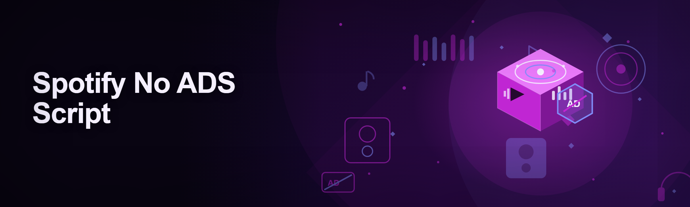
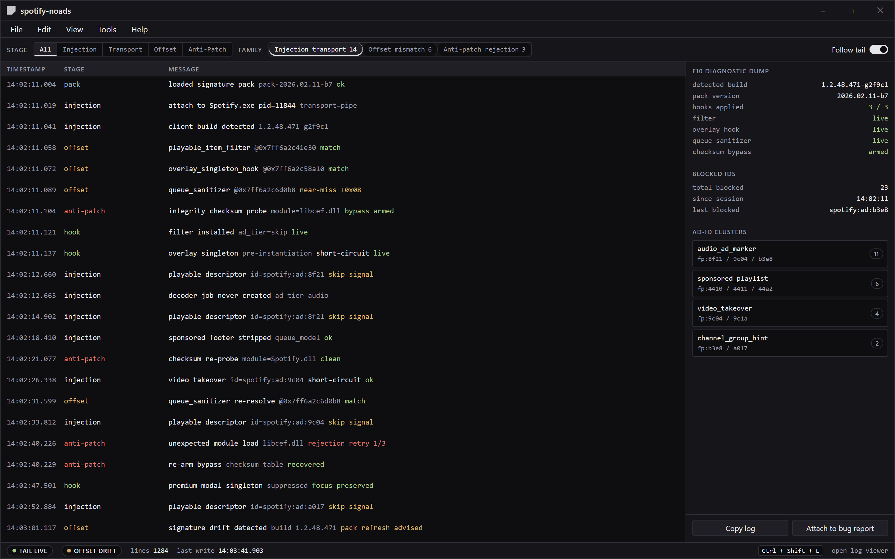

  
  
  

  

  
  

---

I built this because the current meta of "adblockers for Spotify" is genuinely miserable, and I've spent three years watching people fight the same losing battles.

Spotify's 2025–2026 client hardened the desktop app considerably. The old Hosts-file trick that half the YouTube tutorials still recommend stopped working the moment Spotify moved audio delivery behind a CDN that shares the same origin as track streaming. DNS blocking now just makes the player fail politely with a "can't play this right now" toast, then un-fails the moment it retries. Browser extensions died too — the native app ignores them entirely, and the web player keeps pushing you back toward the desktop client.

Here is the actual pile of pain points I hear every week:

- **Ads re-inject on every client update.** You patch, Spotify silently rolls you to a new build overnight, and your audio ads are back by morning. Manually re-patching every few days is not a workflow.
- **Audio ads are unmutable at the mixer.** Even if you drop Spotify's channel in Volume Mixer, the client reports "ad playing" and there's no skip affordance until it finishes.
- **Premium nag modals block the queue.** The "Free listening has limits" overlay interrupts mid-song on desktop and steals keyboard focus until dismissed.
- **Web player workarounds break codec rendering.** Forcing the web player via a modified hosts file causes audio skips, because Spotify gates Opus/AAC quality on the client identity.
- **Autoplay and sponsored-playlist surfacing sneaks ads in via the queue.** These aren't "ads" in the traditional sense, so most classic blockers never touch them.
- **Paid "ad-free Spotify" tools charge for a script that gets patched out in weeks.** The ecosystem is full of abandoned Patreon wrappers around the same three public signatures.

The real issue? Nobody treats Spotify ad suppression like the ongoing reverse-engineering job it actually is. That's what I'm doing here.

  

---

## 🛠️ The Solution — A Maintained Runtime Patcher

The point of `spotify-noads` isn't to be another one-off script. It's the ongoing maintenance layer: the signatures get refreshed, the detection surface gets widened, and the release cadence matches Spotify's own updates.

| Problem | Solution |
| --- | --- |
| Ads return after client updates | Signature pack is version-gated; the tool auto-detects the client build and refuses to apply stale offsets — you get a clear prompt to pull the latest pack instead of a broken patch. |
| Audio ads unmutable | Ad-suppression hook terminates playback of ad-tier segments at the playable-item level, not the volume mixer — the ad is skipped, not silenced. |
| Premium nag overlay blocks the queue | Overlay suppression runs on the renderer — the modal is never created, so keyboard focus stays on the app. |
| Web player workaround breaks codecs | Tool operates on the native desktop client. No codec renegotiation, no quality loss. |
| Sponsored playlist / autoplay injection | Queue sanitizer strips sponsored-item metadata before it reaches the playable-model layer. |
| Paid wrappers go stale | Fully open-source, MIT, and the `.exe` ships without a fixed filename so a fresh build always swaps in-place. |

---

## ⌨️ Hotkeys / Controls

The tool lives in a tray icon; almost no interaction is required outside the launcher. Bindings mirror the launcher window.

| Key | Action | Notes |
| --- | --- | --- |
| `F8` | Toggle ad suppression on/off | Fires the patch controller live — no client restart. Useful for confirming a video takeover was suppressed. |
| `F9` | Force re-apply patch pack | Re-runs the signature injection. Sits on top of the auto-detect hook in case the client was hot-swapped mid-session. |
| `F10` | Dump current client telemetry | Writes a `.log` next to the `.exe` listing detected build, hooks previously applied, and any blocked IDs. First thing to attach in a bug report. |
| `Ctrl + Shift + R` | Restart Spotify and re-hook | Cleanly kills the running client, waits for the tray process to exit, restarts, re-applies. |
| `Ctrl + Shift + D` | Soft-disable and restore vanilla | Reverts the runtime patches so you can confirm whether a playback bug is the tool's fault. |
| `Ctrl + Shift + L` | Open the log viewer | Live tail of the patch pipeline. |
| `ESC` (in launcher) | Stop patch loop | Immediately unregisters the injection loop; running session continues on memoized state until restart. |

> Hotkeys are global and only register while the tray process is running. Avoid overlap with `Ctrl+Shift+R`-using editors — the tool exposes rebinding in `settings.toml` if you need a workaround.

F10 dump and live pipeline tail — build string, applied hooks, blocked ad IDs, triaged by failure family.

---

## 🗺️ Roadmap / Planned Features

| Feature | Status | ETA |
| --- | --- | --- |
| Audio ad-slot suppression | Shipped | Q4 2025 |
| Banner & take-over suppression | Shipped | Q4 2025 |
| Modal/nag kill switch | Shipped | Q4 2025 |
| Sponsored playlist queue sanitizer | Shipped | Q1 2026 |
| Automatic signature pack updater | Shipped | Q1 2026 |
| Anti-anti-patch integrity checksum bypass | Shipped | Q1 2026 |
| Discord presence scrub (no "listening to ad") | Shipped | Q2 2026 |
| Portable settings export / import | In progress | Q2 2026 |
| Ad-ID telemetry dashboard | In progress | Q3 2026 |
| Diagnostic bundle generator (F10 v2) | Planned | Q3 2026 |
| Multi-profile patch (work/personal Spotify accounts) | Planned | Q4 2026 |
| Linux / Proton compatibility | Under research | TBD |

---

## ⚖️ Comparison — Spotfire-the-Hat-AdBlock-Edition vs. This

Fair framing: there are legitimate alternatives, and each has a real use case.

| Aspect | Alternative (hosts / DNS blocker) | This Tool |
| --- | --- | --- |
| Scope | Blocks ad CDN requests only | Suppresses baked-in ad playback and sponsored queue injection |
| Survival across client updates | Static, breaks silently | Version-gated signature pack |
| Recovery when blocked | Player errors until auto-unrestored | Hotkey restore path always available |
| Audio quality impact | Opus fallbacks common | Native decode path, no renegotiation |
| Premium modal handling | None | Overlay renderer suppressed |
| Reversibility | Manual / error-prone | `Ctrl + Shift + D` |
| Update channel | You re-download and redo the guide | `.exe` packaged with rolling packs |
| Legal-ish gray area | Same | Same |

---

## 🧠 AI Integration — Where Model-Assisted Help Actually Earns Its Keep

Despite the noise, 2026's tooling landscape is genuinely better with ML in the loop — not for the patch itself, but for the maintenance overhead that used to eat my weekends.

- **Signature discovery.** The signature pack is produced from a client build by a differential-analysis pipeline. A compact classifier scores candidate offsets by comparing post-patch playback events against ad-only and track-only reference traces, so the human reviewer sees a ranked shortlist, not a wall of hex.
- **Ad-ID clustering.** New ad IDs surface weekly. A clustering pass groups them by the ad network's structural fingerprint (audio ad markers, channel group IDs, sponsored-playlist flags) so one signature covers a whole family instead of one ID.
- **Version compatibility guesser.** When Spotify ships an unannounced build, the tool asks the AI-driven matcher to try near-miss offsets from adjacent builds before it announces "not supported yet" — cuts false negatives in the field.
- **Error triage.** F10 logs are auto-classified by failure family (injection transport, offset mismatch, anti-patch rejection) so bug reports land in the right triage lane instead of me manually re-reading 40 lines.
- **Docs & onboarding.** The FAQ here and the in-app first-run walkthrough are maintained with model help — always reviewed by a human, never auto-published.

What AI *doesn't* do: it never phones home with your listening history, and it never ships a "cloud-sync" feature. All inference runs local to the `.exe` and against packs you download yourself.

---

## 🤝 Community & Support

- **Bug reports / feature requests:** open an issue with your F10 log and the Spotify client build string. Without both, triage slips.
- **Signature packs:** community submissions are reviewed and rolled into the next release; include the ad ID cluster you hit and the build you were on.
- **Regressions after a Spotify update:** `Ctrl + Shift + D` reverts to vanilla before you restart the `.exe`. This is the single most useful troubleshooting step — please try it first.
- **Contributing:** docs, translations, and triage help are as valuable as patch submissions. Please read the issue templates before opening a PR.
- **Priority-category bug reports** get a response buffer for the first week after a fresh Spotify release, because that's when the ecosystem is loudest.

If you're here because a Premium nag interrupted the queue mid-track — you're in the right place.

---

## 🔧 How It Works — Inside the Patch Pipeline

The `.exe` is a runtime patcher, not a replacement for the Spotify binary. It attaches to the Spotify desktop client's UI and network layers on launch, and rewrites the small handful of decision points that decide whether a given playable item is served to the player. Concretely, three kinds of patches are applied:

First, a **playable-item filter** wraps the pipeline that maps Spotify's server-returned track descriptors into local decoder jobs. Any descriptor flagged as an ad (there's a marker in the item metadata, and the marker has stayed remarkably stable across 2023–2026 builds) gets a terminal "skip" signal — the track is never decoded, never counted, never voiced.

Second, an **overlay renderer hook** runs on the Electron AppKit path. Spotify creates its Premium nag as a separate overlay singleton; the hook watches for the singleton's instantiation message and short-circuits before the WebView layer attaches. This is why focus-stealing goes away — the modal never exists to steal focus.

Third, a **queue sanitizer** that watches for the sponsored-item footer on free-tier streams and strips the sponsored-item object out before it reaches the queue model. This catches the sponsored-playlist-sourced inserts that classic DNS blockers never see because they arrive from the same origin as real tracklist data.

The patches don't persist. They live entirely in memory, they're re-applied on every client launch, and a plain `Ctrl + Shift + D` drops everything back to vanilla in under a second. There's no install directory, no registry write, and no background daemon that survives exiting Spotify — if Spotify is closed, the tool has nothing to do. The `.exe` sits in a folder with the current pack, and the "current pack" itself is just a version-tagged JSON blob the tool can download when you ask it to.

A short note on the anti-anti-patch side: Spotify's client verifies some of its own modules' checksums on launch. Overwriting bytes on disk would trip that. That's why this tool never patches on disk — it intercepts at method call time. Nothing Spotify's integrity scanner can see is changed; what changes is what the intercepted method returns. That's the whole trick, and it's why it survives updates between signature refreshes and why it needs a re-apply when a critical signature retires.

---

## 🌟 Key Features — Module Matrix

| Feature | Description | Benefit |
| --- | --- | --- |
| Audio ad suppress | Skips ad-tier audio at the playable-item layer | Zero ad audio, uninterrupted queues |
| Video takeover skip | Short-circuits the takeover overlay | No click-throughs |
| Banner collapse | Removes the ad rails in the home view | Cleaner UI, no accidental clicks |
| Premium modal kill | Suppresses the overlay singleton before render | Focus never stolen |
| Sponsored queue sanitizer | Strips sponsored-playlist inserts | Autoplay stays on your tracks |
| Version-gated packs | Refuses stale offsets when a fresh Spotify build ships | No silent patch breaking |
| Automatic pack updater | Pulls new signature packs on demand | No manual re-download |
| F10 diagnostic dump | Writes current client + patch state to log | Reproducible bug reports |
| Hotkey re-apply (F9) | R-eruns pack on running client | Recovery in under a second |
| Soft-disable (Ctrl+Shift+D) | Instant vanilla revert | Isolate tool vs. Spotify bugs |
| Discord-presence scrub | Avoids "listening to: [ad]" | Presence stays clean |
| Portable, no registry write | Runtime-only, uninstall-safe | Zero system footprint |
| Custom tray hotkeys | `settings.toml` rebind | No editor clash |
| Signed builds | SHA-256 checksums per release | Verify what you're running |

---

## 🚀 Quick Start — Three Steps to Silence

1. 🎧 **Download the release package.** Grab the `.exe` bundle from the project page. Extract it to any folder of your choice — portable by design, nothing installs to a system directory.

2. 🎚️ **Exit Spotify first.** Quit from the tray (not just close the window) — the

[…truncated for layout…]